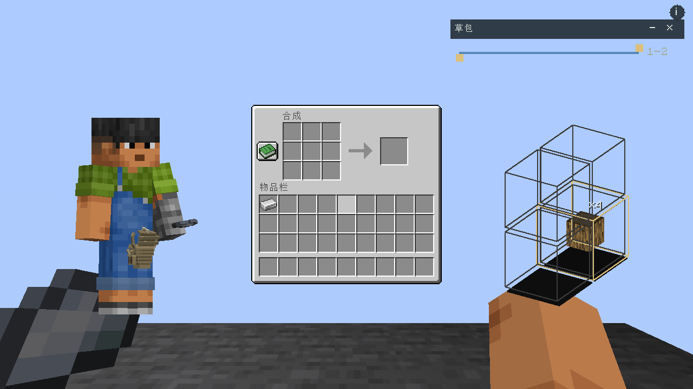
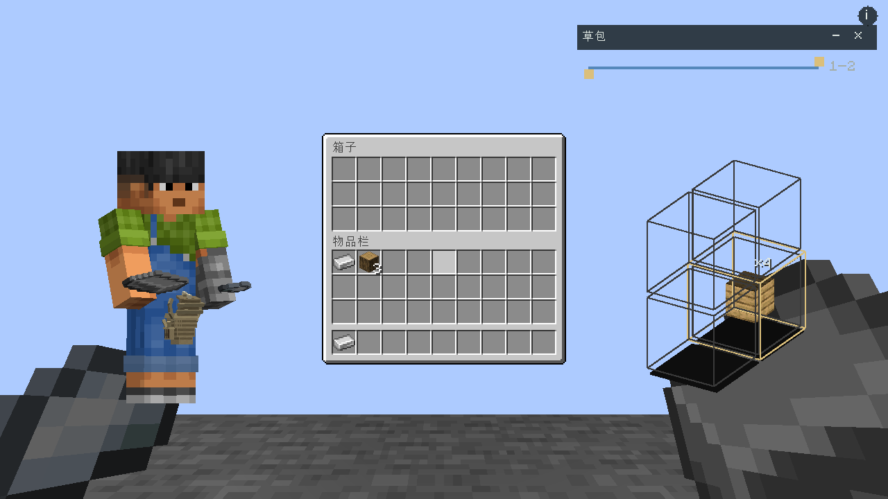

# BS3D Vanilla Addon

原版工作站与容器的 BS3D 交互附属。保留原版操作区，在两侧显示可旋转的玩家模型与背包内景；双手、盔甲及背包物品可以拖向原版槽位，也可以存回。

Fabric 1.20.1 · Java 17 · MIT · `0.1.0-SNAPSHOT`，尚未发布正式版本，API 未冻结。

- 工作台、熔炉、高炉、烟熏炉、铁砧、锻造台、砂轮、切石机、织布机、制图台、附魔台、酿造台、信标。
- 箱子、陷阱箱、末影箱、木桶、潜影盒、漏斗、发射器和投掷器等原版容器。
- 原版配方、燃烧、经验和槽位限制仍由原版 `ScreenHandler` 处理。
- 背包取放由服务器计时、校验并提交；ESC 取消。附属协议使用 Protobuf，走 Framework 统一路由。
- 客户端 JAR 包含同一套逻辑服务器代码，支持单机；专用服务器使用独立 server JAR。

截图来自真实 Fabric 客户端联调；另见[熔炉截图](docs/images/furnace.png)。

接入文档唯一来源为 [docs/wiki](docs/wiki/Home.md)：[安装与构建](docs/wiki/Getting-Started.md) · [操作与兼容范围](docs/wiki/Interaction.md) · [通信协议](docs/wiki/Protocol.md) · [验证记录](docs/wiki/Validation.md)。

依赖 [Inventory UI Framework](https://github.com/Kizunad/Kizuna-Inventory-UI-Framework) 和 [Backpack and Storage 3D](https://github.com/Kizunad/backpack-and-storage-3D)。不依赖重量附属，可与之共同安装。
